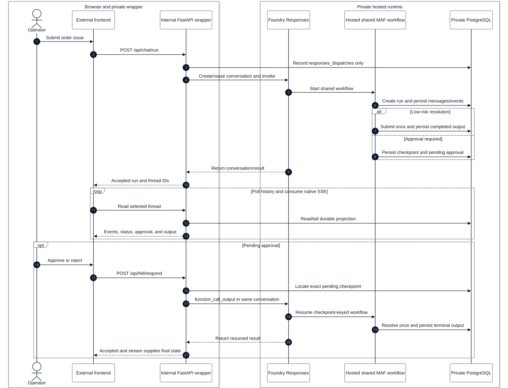

# Architecture: Order Resolution Workflow

## Purpose and 4+1 model

This document uses the **4+1 architectural view model** for the private
Foundry lane:

1. **Logical view** defines the single business decision path and its
   responsibility boundaries.
2. **Process view** defines sequential execution, durable HITL pause/resume,
   and the separate-process wrapper behavior.
3. **Development view** maps boundaries to source modules and browser/API
   contracts.
4. **Physical view** defines private network, identity, ingress, and durable
   storage boundaries.
5. **Scenarios (+1)** make the design testable through low-risk completion,
   approval, rejection, recovery, and selected-thread privacy isolation.

It is the design map for the sequential MAF workflow, durable approval
boundary, private browser/API topology, and approved additive selected-thread
contract. Repository configuration and design documents express intent; dated
deployment, trace, evaluation, and release evidence belongs in
[issues-changes-fixes.md](issues-changes-fixes.md).

## Business Problem

Support teams need to resolve delivery and product issues quickly while keeping
risky actions, such as refunds and sensitive resolutions, under explicit human
control. The system must:

- automate common low-risk cases;
- require an explicit human decision for defined high-risk cases;
- retain the run, event, transcript, checkpoint, and approval history needed
  to explain what happened; and
- provide a stable operator timeline without exposing private platform
  credentials or data planes to the browser.

## Project Goal

Deliver a verifiable order-resolution workflow that is:

- **sequential:** one MAF business path progresses through triage, policy
  retrieval, and resolution;
- **decision-safe:** deterministic HITL rules and a durable checkpoint gate
  approval, rejection, and resume;
- **durable:** PostgreSQL owns workflow/audit projections across process
  restarts;
- **contract-preserving:** native SSE remains the stable browser contract;
  AG-UI and CopilotKit are optional selected-thread projections only; and
- **private-lane preserving:** only the frontend has general application
  ingress. The wrapper, Foundry Responses/data/management APIs, ACR, and
  PostgreSQL remain on VNet/private paths; Teams uses only the narrowly scoped
  Activity route described below.

## Logical View

The logical view follows one customer issue from intake through ordered
assessment, deterministic resolution policy, and either automatic completion
or an explicit human decision:

Diagram source: [logical-decision-flow.mmd](diagrams/logical-decision-flow.mmd).



### Business Decision Model

1. **Triage** records a concise order/issue summary. When Foundry model
   settings are present, the MAF `SequentialBuilder` runs triage, policy, and
   resolution participants in order and emits observable MAF stream signals.
   If settings are absent, deterministic triage remains inside that workflow;
   it does not select a second orchestration path.
2. **Policy, MCP, and RAG retrieval** derives the order ID and issue type,
   reads local order/policy tools, queries the configured RAG provider, and
   calls the MCP knowledge port. Retrieval data is backend execution context,
   not selected-thread assistant context.
3. **Resolution** deterministically chooses an action and checks whether it
   requires approval. Current rule conditions are amount/risk of at least
   `100`, damaged item, or `manual_review` policy. The authoritative conditions
   and test inputs are in
   [business-rules.md](business-rules.md) and
   [hitl-approval-conditions.md](hitl-approval-conditions.md).
4. **Completion or human decision** submits a low-risk action once, or writes a
   durable HITL checkpoint before any gated action completes.

The model can summarize or explain a case, but it does not replace the
deterministic policy or HITL decision.

### Logical Responsibility Boundaries

Diagram source: [logical-boundaries.mmd](diagrams/logical-boundaries.mmd).



| Boundary | Responsibility | Prohibited shortcut |
| --- | --- | --- |
| Browser UI | Start a run, read durable history, consume native SSE, and submit a human decision through the same-origin proxy. | Direct Foundry, PostgreSQL, MCP/RAG, or secret-bearing access. |
| API/application service | Create a local run or delegate wrapper-mode start/resume to Foundry Responses. | A second hosted-only workflow/orchestrator. |
| MAF runtime | Ordered triage, retrieval, resolution, and checkpoint-keyed HITL behavior. | Replacing the stable SSE or checkpoint contract. |
| Infrastructure adapters | PostgreSQL, MCP, RAG, Foundry Responses, and event-bus access behind ports. | Leaking adapter data to browser projections. |
| PostgreSQL | Application-owned durable workflow and audit state. | Treating a Foundry conversation as the audit source of truth. |

### Teams Publication and Plane Boundaries

Teams publication does not make the Foundry project generally public. The
boundary is intentionally split by plane:

| Plane/path | Network and authorization posture |
| --- | --- |
| Foundry Responses runtime and normal project/data APIs | Private endpoint/VNet path with Entra authorization. Responses remains the first verification path before Teams work begins. |
| Data dependencies | PostgreSQL, ACR, model/tool connections, private DNS, and application secrets remain private and are never exposed to Teams or the browser. |
| Management/control | Bot Service and `MsTeamsChannel` are declarative ARM/Bicep resources. Foundry account/project management remains authenticated and is not opened for Teams traffic. |
| Teams Activity | Microsoft 365 uses a service-managed public Activity route because it cannot call Private Link. The route is source-IP filtered and applies only to Activity Protocol. |
| Activity authorization | Public reachability is not anonymous. A valid Bot token and the selected `BotServiceRbac` (`Shared`) or `BotServiceTenant` (`Tenant`) authorization, tenant checks, and platform RBAC are still required. |

`iac/teams/main.bicep` creates a single-tenant Bot Service with
`publicNetworkAccess: 'Disabled'`, its `MsTeamsChannel`, and the Foundry
Activity URL after the hosted agent exists. The endpoint itself is not an ARM
resource. `reconcile_activity_endpoint.py` therefore performs a controlled
Foundry data-plane GET/plan/PATCH/rollback that preserves Responses, Entra,
unrelated protocols, and non-Bot authorization while adding or removing the
Activity route.

Microsoft 365 catalog publication is also a Foundry data-plane POST orchestrated
by `publish_teams_agent.py`; it is not Bicep. `Shared` publication and
installation must be validated with an interactive user first. Promotion to
tenant-wide `Tenant`/`BotServiceTenant` and Microsoft 365 administrator
approval is a later governance step, not part of initial Shared validation.
Bot/channel, Activity configuration, Shared publication, authentication, and
normal Teams invocation are deployed and manually verified. Adaptive Card
Approve/Reject is also deployed and accepted, including typed-decision
blocking, replay rejection, and conversation isolation.
No documented unpublish API is automated.

### Approved Selected-Thread Boundary

The selected-thread contract is an optional logical read model for **one
existing** workflow thread:

- Native SSE and durable workflow history remain the source of truth.
- `GET /api/chat/stream/{thread_id}/ag-ui` and `POST /api/copilotkit` may
  project only allowlisted durable-event information.
- `GET /api/copilotkit/info` (with `GET /api/copilotkit` as an alias) returns
  static, redacted discovery. CopilotKit is `@copilotkit/react-core`, not the
  GitHub Copilot SDK.
- Only `threadId` is meaningful bridge input. Compatible `runId`, `messages`,
  `state`, `tools`, `context`, and `forwardedProps` values are discarded.
- The projection never starts, resumes, approves, rejects, or otherwise
  changes a workflow.
- Order/customer data, policy and policy-evidence data, MCP/RAG content, tool
  arguments/results, prompts, raw model output, reviewer comments, checkpoint
  payloads, credentials, and secrets never cross this boundary.

The private frontend and selected-thread boundary are implemented. The
TypeScript 7/Zod 4/CopilotKit 1.79 dependency graph is locally validated and
deployed. Hosted release, Activity, telemetry, and evaluation evidence is
maintained in the
[review remediation release](issues-changes-fixes.md#review-remediation-release-2026-10-21).

## Process View

The process view describes sequential execution, durable handoff, and
checkpoint-keyed approval/resume.

Diagram source: [hosted-hitl-sequence.mmd](diagrams/hosted-hitl-sequence.mmd).



### Local Order-Resolution Flow

1. The browser calls `POST /api/chat/run` with a message and optional
   thread/session identifiers.
2. `OrderResolutionService` assigns IDs, creates the `workflow_runs` record,
   and starts the shared MAF workflow.
3. The workflow persists the user message, emits a `workflow.stage` for
   triage, and produces its sequential triage result.
4. Policy retrieval emits its stage events, obtains local policy/order data,
   performs RAG and MCP reads, and emits the stable `tool.call` event.
5. Resolution chooses the action and determines whether approval is required.
6. A low-risk decision performs the idempotent resolution submission, appends
   the assistant message, and emits terminal `workflow.output`.
7. A high-risk decision enters the durable HITL branch rather than submitting
   the action.
8. The event bus publishes native events to local subscribers while its
   projector writes the durable event/run state used by history and wrapper
   streams.

### Durable HITL Pause, Decision, and Resume

The approval branch is a state transition, not a transient UI prompt:

1. The workflow writes a PostgreSQL checkpoint with order/action state,
   run/session identifiers, and sanitized trace context.
2. It emits `checkpoint.created`, then `hitl.request`, and returns waiting.
   No resolution submission occurs at this point.
3. An operator submits `POST /api/hitl/respond` with the checkpoint ID,
   `approve` or `reject`, reviewer, and optional comment.
4. The checkpoint store atomically resolves the pending checkpoint. A duplicate
   response is not a second approval or resolution.
5. On **approve**, the workflow resumes from checkpoint context, records
   `hitl.response`, submits through its idempotency key, and emits a
   `completed` `workflow.output`.
6. On **reject**, it records `hitl.response` and emits an `escalated`
   `workflow.output` without submitting the proposed resolution.

The persisted checkpoint trace context becomes the parent of the resume span,
so the approval and final outcome remain correlated with the original pause.

### Private Hosted Request and Resume Flow

The private topology preserves the browser contract while keeping the wrapper,
Foundry, and PostgreSQL internal:

```text
operator browser
  -> external React/Nginx Container App
  -> same-origin /api proxy
  -> internal FastAPI Responses-wrapper Container App
  -> managed-identity private Foundry Responses endpoint
  -> hosted MAF workflow
  -> private PostgreSQL workflow/checkpoint/event state
```

For an initial wrapper request:

1. The wrapper records a request-hash/idempotency entry in
   `responses_dispatches`.
2. Its Responses client creates a Foundry `conv_...` conversation before the
   first Responses request and returns that conversation ID as the
   browser-visible thread.
3. `backend/foundry/main.py` runs the shared workflow using that
   conversation/thread identity and writes durable projections.
4. Initial dispatch is non-streaming. While the hosted agent creates the
   durable projection, the UI polls its selected thread and subscribes to
   native SSE.

For an approval or rejection, the wrapper looks up the pending durable
approval and sends checkpoint-keyed `function_call_output` in the same Foundry
conversation. The hosted entrypoint parses the decision and performs the
durable resume path above. Because wrapper and hosted agent are separate
processes, wrapper mode tails persisted `workflow_events`; it does not depend
on the in-memory event bus.

### Optional Selected-Thread Read Flow

The selected-thread read flow neither dispatches a workflow nor modifies a
checkpoint:

```text
selected existing thread
  -> same-origin AG-UI or CopilotKit request
  -> internal wrapper validates selector and ignores compatibility inputs
  -> allowlisted durable-event projection
  -> optional panel renders safe status
  -> optional panel failure leaves native SSE/history/HITL available
```

## Development View

There is one business workflow implementation and one application-service
boundary. The local FastAPI route and Foundry Responses host are distinct
adapters to that shared behavior; the private wrapper delegates and tails
durable state rather than orchestrating a parallel workflow.

Diagram source: [development-ownership.mmd](diagrams/development-ownership.mmd).



### Core Modules and Ownership

| Concern | Source ownership | Responsibility |
| --- | --- | --- |
| HTTP and SSE | `backend/app/api/v1/routers/*` | Stable chat, HITL, history, health, rich-event, AG-UI, and CopilotKit endpoint ownership. |
| API contracts | `backend/app/api/v1/schemas/*` | Request/response validation for chat, HITL, workflow, session, and bridge interactions. |
| Application/domain | `backend/app/modules/order_resolution/*` | Service seam, workflow context/events, ports, durable projections, and selected-thread projection rules. |
| Runtime composition | `backend/app/core/*` | Runtime-target configuration, PostgreSQL/event-bus composition, and telemetry. |
| MAF workflow | `backend/app/maf/*` | Prompts, agents, tools, sequential stages, HITL, runner, and middleware. |
| Adapters | `backend/app/infrastructure/*` | PostgreSQL repositories, checkpoint/session/idempotency stores, MCP/RAG, Foundry Responses client, and event bus. |
| Foundry host | `backend/foundry/main.py` | Responses protocol parsing, invocation tracing, and construction of the same hosted MAF path. |
| Browser UI | `frontend/src/*` | Native timeline and approval presentation, plus optional read-only selected-thread AG-UI/CopilotKit presentation. |

`RUNTIME_TARGET=local_maf` runs the workflow from FastAPI for local validation.
`RUNTIME_TARGET=responses_wrapper` makes FastAPI the private Responses wrapper:
it delegates start/resume to Foundry and reads durable projections. The wrapper
does not implement a hosted-only orchestrator.

### Browser and Event Contracts

The native envelope and payload conventions are defined in
[schema-io-telemetry.md](schema-io-telemetry.md). These native event types are
the stable SSE contract and must not be renamed or replaced:

- `workflow.stage`
- `tool.call`
- `checkpoint.created`
- `hitl.request`
- `hitl.response`
- `workflow.output`

| Endpoint | Contract |
| --- | --- |
| `POST /api/chat/run` | Starts a local run or delegates initial work to Foundry in wrapper mode. |
| `GET /api/chat/stream/{thread_id}` | Stable native SSE; wrapper mode replays and tails persisted events. |
| `GET /api/chat/stream/{thread_id}/rich` | Additive `workflow.rich` envelope for compatible consumers; not a redacted assistant stream. |
| `GET /api/chat/stream/{thread_id}/ag-ui` | Approved additive, selected-thread native AG-UI projection. |
| `POST /api/hitl/respond` | Resolves one durable checkpoint with approve or reject. |
| `GET /api/workflows*` and `GET /api/sessions/{session_id}/messages` | Durable workflow/event and transcript read models. |
| `GET /api/copilotkit[/info]`, `POST /api/copilotkit` | Static discovery and approved read-only selected-thread bridge contract. |

### Privacy-Safe AG-UI and CopilotKit Contract

AG-UI and CopilotKit are optional additive views. They never replace native
SSE, durable history endpoints, or the workflow:

- They read and tail persisted events so the view remains compatible with
  separate wrapper and hosted-agent processes.
- They may emit `RUN_STARTED`, safe `STEP_*`/`TOOL_CALL_*` frames, CUSTOM
  checkpoint/approval summaries with validated UUIDs and approved/rejected
  decisions, generic terminal/error text, and `RUN_FINISHED`.
- They reject the `/rich` envelope as an assistant source because its
  native-event/raw-event content is not the selected-thread privacy contract.
- The frontend context is limited to selected thread ID, normalized status,
  safe event type/timestamp, pending-approval count, and output presence.
- The client must present malformed, unavailable, and non-JSON optional stream
  errors without disrupting native workflow controls.

## Physical View

### Hosted Execution and Network Boundary

The private browser design has one externally reachable application component,
plus the source-filtered, service-managed Activity exception used only by
Teams:

Diagram source:
[private-physical-topology.mmd](diagrams/private-physical-topology.mmd).



The Container Apps environment is VNet-integrated on a dedicated subnet. It
must not reuse the Foundry agent-host subnet. The backend, normal Foundry
Responses/data/management paths, ACR, and PostgreSQL remain private. The
browser never receives a Foundry endpoint credential, Foundry access token,
database credential, backend ingress URL, or MCP/RAG endpoint. Only the
internal wrapper uses managed identity for private Responses calls. Activity
callers still require Bot token, tenant, and RBAC authorization; source-IP
filtering is an additional network control, not identity.

`POSTGRES_SERVER_NAME` and `RUNTIME_DATABASE_URL` must identify the same
canonical Flexible Server FQDN. PostgreSQL is created with public network
access disabled and no Azure-services firewall rule. The VNet runner validates
the approved private endpoint, private DNS mapping, schema, and least-privilege
runtime role before application deployment.

### Durable Stores and Recovery

PostgreSQL is the durable application store:

| Store | Purpose |
| --- | --- |
| `workflow_runs` | Per-thread status, summarized input, current stage, timing, and latest output. |
| `workflow_events` | Append-only ordered native timeline used by history and durable SSE. |
| `conversation_messages` and `sessions` | Thread transcript and session association. |
| `checkpoints` and `approvals` | Durable HITL state, reviewer decision, comments, and audit timestamps. |
| `idempotency_keys` | One-time resolution-submission protection. |
| `responses_dispatches` | Wrapper request-hash/idempotency lifecycle and resolved Foundry conversation thread. |
| `eval_runs` and `eval_results` | Local evaluation records. |

Read/model operations have bounded retry behavior. Resolution submission is
side-effecting and is protected by the workflow-run/step/business idempotency
record rather than a blind retry. Event insertion is idempotent by event ID.
These properties let a restart or repeated approval request recover from
durable state without repeating the resolution.

### Observability and Privacy

Telemetry uses OpenTelemetry/MAF instrumentation and exports through the
project's Azure Monitor Application Insights connection when configured. The
operational signal includes:

- Foundry Responses invocation;
- `workflow.run`, stage spans, `workflow.hitl_waiting`,
  `workflow.hitl_resume`, and `workflow.resolution_submit`;
- MAF `executor_invoked`, `executor_completed`, and `output` observations; and
- correlation attributes for thread, run, session, checkpoint, status, and
  Foundry conversation identities.

The private hosted agent receives only the platform-injected
`APPLICATIONINSIGHTS_CONNECTION_STRING`; do not add instrumentation-key
fallbacks or map telemetry credentials into browser configuration. Health,
SSE, and workflow-history/detail polling transport requests are excluded from
request telemetry so workflow, Foundry/model, and HITL spans remain the
operational signal. `OTEL_RECORD_CONTENT=false` remains the default.

The pinned upstream template 15 audit does not change this monitoring design.
AMPLS and private Application Insights ingestion remain out of scope.

## Scenarios (+1 View)

Each scenario uses the same sequential workflow and durable PostgreSQL
projections; none creates another orchestration path.

| Scenario | Logical decision | Process and recovery behavior | Observable/operator outcome |
| --- | --- | --- | --- |
| `ORD-1001` low-risk late delivery | Policy permits automatic resolution. | Triage, retrieval, and resolution complete in order; idempotent submission writes one terminal result. | Native SSE ends with `workflow.output`; durable history shows `completed` with no `hitl.request`. |
| `ORD-1009` high-amount delay, approved | Deterministic threshold requires approval. | The workflow saves a checkpoint, pauses, and resumes once from it after approval; duplicate approval is idempotent. | Timeline shows `checkpoint.created`, `hitl.request`, `hitl.response`, and terminal output; traces correlate wait and resume. |
| Damaged item, rejected | Damaged-item policy requires review; reviewer rejects proposed action. | Checkpoint resolves once and the workflow records rejection without the side-effecting submission. | Durable event history ends in `escalated`; approval audit identifies reviewer and decision. |
| Teams Adaptive Card decisions and isolation | A pending checkpoint emits one card with Approve and Reject `Action.Execute` buttons; typed decisions are ignored. | Opaque action tokens are hashed, expiring, one-time, and bound to the exact checkpoint, decision, Teams user, and conversation. | Accepted: cross-conversation and replay submissions are rejected; successful actions resolve the intended workflow and update the card. |
| Private wrapper restart/reconnect | Browser request remains tied to one Foundry conversation/thread and durable run state. | Wrapper replays/tails PostgreSQL `workflow_events`, not an in-memory bus. | Operator can reload history and native SSE without duplicate dispatch or loss of pending approval. |
| Selected-thread assistance | Assistant may present lifecycle state but cannot decide or perform a resolution. | AG-UI/CopilotKit reads allowlisted persisted projections only. | The UI receives safe labels/status/checkpoint summaries; raw order/policy/MCP/RAG/checkpoint data remains server-side. Local and protected release evidence are recorded in the release ledger. |

## Execution Surfaces and Release Behavior

The supported private execution surfaces are:

1. **Local full stack:** React, FastAPI, native SSE, and PostgreSQL for
   UI/API/event-contract validation.
2. **Private Foundry hosted agent:** `backend/foundry/main.py`, packaged by
   `backend/Dockerfile.hosted`, serves the Responses protocol.
3. **Private browser path:** external frontend Container App, internal FastAPI
   wrapper Container App, private Foundry Responses, and PostgreSQL durable
   state.
4. **Teams Activity path:** Bot Service/Teams channel to the source-filtered
   Activity exception and the native Activity handler in the same dual-protocol
   hosted process as the private Responses handler.

The current Teams handler sends complete text/cards. Teams SDK streaming is a
separate direct-Activity capability and is not enabled in this increment. File
and image behavior is channel-specific and must be validated in Teams rather
than inferred from Responses or the browser.

GitHub Actions validation remains credential-free. Protected private provision,
reconciliation, application-release, and observability workflows serialize on
`order-resolution-private-release` and run only on `foundry-private-ora` in the
retained private environment. The following boundaries preserve the distinction
between application delivery and shared infrastructure authority:

| Operation | Architectural scope | Boundary |
| --- | --- | --- |
| Routine app-only release | Existing ACA backend/frontend revisions and existing hosted agent. | Validates existing private dependencies; does not run full Bicep, reconcile shared resources, or change PostgreSQL access. |
| Bootstrap/reconciliation | Full Bicep management plane. | Requires a current preview and recorded reconciliation review evidence before execution. |
| PostgreSQL initialization/readiness | Canonical private-only PostgreSQL server, schema, and runtime role. | Private-runner bootstrap and readiness validation must pass before application deployment. |

Preview run `31198356080` found shared authoritative drift in the VNet/subnets,
ACA environment, Foundry account/project/models, ACR, Cosmos, Application
Insights, and Search. Full-Bicep bootstrap/reconciliation is therefore blocked
until recorded review and current validation evidence establish the intended
state. The preview neither deploys the
application nor establishes private dependency health; it must not be reported
as deployment success. Do not add administrator-password, public-access,
firewall, or alternate-runner bypasses.

The current protected app-only release is recorded in the
[review remediation release](issues-changes-fixes.md#review-remediation-release-2026-10-21).
It did not reconcile the shared-resource drift.
This architecture document remains design intent; it does not substitute for
dated release evidence.

## Required Verification

| Concern | Required evidence when the corresponding work occurs |
| --- | --- |
| Sequential low-risk and durable HITL behavior | `make test` |
| Deterministic workflow contract cases | `make eval-backend` |
| Native-SSE, approval, and selected-thread UI | Strict TypeScript check, frontend build/lint, focused selected-thread Playwright coverage, and `make test-e2e` |
| Hosted/runtime report | `make eval-foundry` in accordance with the private release model |
| Teams endpoint/package automation | `make test-foundry-activity-endpoint` and `make test-foundry-teams-publishing`; these validate automation contracts, not successful Microsoft 365 publication |
| Customer demo operation | Follow [the clean-room and Teams demo runbook](customer-demo-runbook.md); retain only sanitized evidence |
| Consolidated local review | `./scripts/skills/design-review-skill.sh` |
| Private hosted release proof | Private-runner release, then dated non-secret evidence in `issues-changes-fixes.md` |

Baseline scenarios are `ORD-1001` (low risk, no HITL), `ORD-1009` (high
amount, HITL), and a damaged-item message (HITL). Future release-ready claims
need private PostgreSQL readiness, hosted smoke/E2E, Foundry evaluation, and
Application Insights correlation required by
[engineering-operating-model.md](engineering-operating-model.md). They must
not be inferred from source configuration or this architecture document.
