# Order Resolution Agent Codebase Review

> Snapshot refreshed for documentation accuracy on 2026-10-21. This is not the
> requested fresh P0 security/architecture review; that review is a separate
> next step. Product behavior and runtime
> contracts remain authoritative in the
> [functional specification](functional-spec.md),
> [business rules](business-rules.md), and
> [technical specification](technical-spec.md).

## Executive summary

The project has one shared MAF order-resolution workflow running through local
FastAPI or a private Foundry Responses hosted agent. PostgreSQL is the durable
application/audit store, native SSE is the stable browser event contract, and
AG-UI/CopilotKit are constrained read-only projections.

The strongest areas are workflow/HITL behavior, durable persistence,
target/provider configuration tests, private topology controls, hosted
protocol tests, telemetry verification, and release evaluation. Remaining
maintainability and security debt is concentrated in application
authentication, API-schema coupling, import-time composition, and large host/UI
coordinator modules.

## Architecture diagram

Source: `diagrams/codebase-component-map.mmd`.

## Component inventory

| Component | Responsibility | Main source |
| --- | --- | --- |
| API routers | Chat, native/rich/AG-UI streams, HITL, history, session, CopilotKit, and health endpoints | `backend/app/api/v1/routers/*` |
| Application service | Local run creation or private Responses dispatch/resume | `backend/app/modules/order_resolution/service.py` |
| Shared workflow | Triage, retrieval, deterministic resolution, checkpoint/HITL, idempotent completion | `backend/app/maf/workflows/order_resolution.py` |
| MAF packages | Prompts, agents, tools, executors, clients, runner, and middleware | `backend/app/maf/*` |
| Persistence | Runs, events, messages, approvals, checkpoints, sessions, RAG, idempotency, and eval records | `backend/app/infrastructure/persistence/*`, `backend/app/sql/schema.sql` |
| Foundry wrapper | Managed-identity Responses calls and dispatch identity | `backend/app/infrastructure/foundry/responses_client.py` |
| Hosted adapter | Responses parsing, hosted invocation, tracing, and checkpoint-keyed decision resume | `backend/foundry/main.py` |
| Frontend coordinator | API calls, selection, polling/SSE, approval, and cross-panel state | `frontend/src/App.tsx` |
| Frontend panels | Composer, history, timeline, approval, output, RAG, metadata, manual test, AG-UI, and selected-thread assistant | `frontend/src/components/studio/*` |
| Release automation | Private validation, images, Container Apps, hosted versions, telemetry/evaluation, evidence, and Teams operations | `scripts/foundry/*`, `Makefile`, `infra/foundry-hosted/*` |

## Data flow

1. `POST /api/chat/run` enters `OrderResolutionService`.
2. Local mode creates the durable run and invokes the shared workflow.
3. Wrapper mode records `responses_dispatches`, creates/reuses a Foundry
   conversation, and invokes private Responses.
4. The hosted adapter invokes the same shared workflow; the workflow creates
   and updates durable run projections.
5. PostgreSQL stores stable workflow events, history, messages, checkpoints,
   approvals, RAG evidence, and idempotency state.
6. The UI polls history and consumes native SSE through the frontend's
   same-origin `/api` proxy.
7. An approval decision is forwarded in the same Foundry conversation using
   the checkpoint ID and resumes only that pending checkpoint.

## Identity and security review

Implemented:

- Foundry calls use managed identity/Entra credentials.
- The browser has no Foundry or database credential.
- Normal Foundry and data dependencies remain private.
- PostgreSQL is private-only and uses a least-privilege runtime role.
- Selected-thread projections exclude execution-sensitive data.
- Release evidence and target profiles are sanitized/ignored.

Open:

1. Chat, HITL, workflow-history, and selected-thread APIs have no application
   authentication or authorization dependency.
2. CORS is open to all origins.
3. Reviewer identity is request-supplied rather than bound to an authenticated
   principal.
4. Foundry parse debug mode can log message previews if explicitly enabled.
5. Teams Activity is intentionally public/service-managed and must retain Bot
   token, tenant, RBAC, and source-filter controls.

## Maintainability review

1. `backend/app/core/container.py` performs composition/schema work at import
   time, which complicates startup isolation.
2. `OrderResolutionService` imports API request/response schemas instead of
   module-owned contracts.
3. The PostgreSQL repository returns API schema objects directly.
4. `backend/foundry/main.py` still combines protocol parsing, decision
   handling, tracing, and hosted invocation in a large module.
5. Visual frontend panels are decomposed, but `frontend/src/App.tsx` still
   coordinates substantial workflow, polling, SSE, and selected-thread state.
6. Search/Foundry retrieval and Foundry memory remain explicit but incomplete
   extension seams and must continue to fail closed.

## Test posture

Current focused coverage includes:

- workflow low-risk, approve, reject, explanation, retry, and idempotency;
- API and persistence reload behavior;
- MAF factory/client and configuration composition;
- order-resolution boundary rules;
- RAG providers and database behavior;
- Foundry hosted protocol and Responses client behavior;
- telemetry query/correlation and strict per-evaluator validation;
- private topology and release portability contracts; and
- seven workflow plus four selected-thread browser scenarios.

Remaining documented gaps:

1. No application auth tests because auth is not implemented.
2. No enforced static dependency rule preventing API-schema imports into
   service/persistence layers.
3. Frontend behavior is covered primarily through Playwright rather than
   component/unit tests.
4. The TypeScript 7/Zod 4 frontend dependency modernization is deployed and
   release-verified.

## Review remediation status

The review inventory produced six actionable findings. All six are remediated
in the current release. Deferred product hardening remains documented where it
belongs, including production application authentication/authorization and
trusted reviewer identity.

## Current verification

The active hosted version and the latest Responses, Activity, telemetry,
evaluation, database, and timing evidence are in the
[review remediation release](issues-changes-fixes.md#review-remediation-release-2026-10-21).
