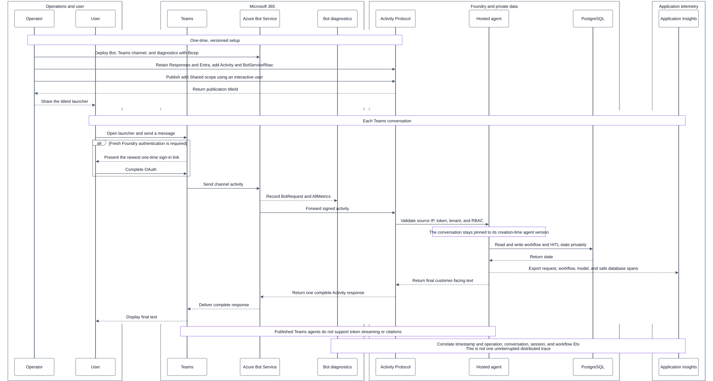

# Securely Publish a Private Microsoft Foundry Agent to Teams

## Verified design

The order-resolution agent remains in a private Microsoft Foundry project.
Microsoft Teams reaches only the service-managed Activity Protocol route, which
is source-IP filtered and protected by the signed channel token, tenant
validation, and `BotServiceRbac`.



Two separate controls are required:

1. **Shared publication and selective distribution** control who can discover
   or acquire the agent.
2. **Foundry RBAC through `BotServiceRbac`** controls who can invoke it, even if
   its launcher link is forwarded.

The Microsoft 365 channel does not use the project's private endpoint. The
normal Responses, management, model, tool, and data paths remain private.

Current implementation status: Shared publication, authentication, normal
Teams invocation, and secure Adaptive Card Approve/Reject are deployed and
accepted. The current release evidence is recorded in
[issues-changes-fixes.md](issues-changes-fixes.md#review-remediation-release-2026-10-21).

## Implementation and runtime process



### 1. Authorize the selected users

Create a Microsoft Entra security group for the approved users and assign the
minimum Foundry role required to invoke the agent. Apply the assignment at the
narrowest supported Foundry project scope.

Do not treat the group or Shared catalog as the runtime security boundary.
Foundry RBAC is authoritative.

### 2. Deploy the Azure Bot Service bridge

The Teams Bicep deployment owns:

- A single-tenant Azure Bot Service resource that uses the Foundry agent
  identity client ID and tenant ID.
- The `MsTeamsChannel` resource with accepted terms and the commercial
  deployment environment.
- `publicNetworkAccess: Disabled` on the Bot Service resource.
- `BotRequest` diagnostics and `AllMetrics` sent to the deployment's Log
  Analytics workspace.

The messaging endpoint must include the Activity API version:

```text
https://<resource>.services.ai.azure.com/api/projects/<project>
/agents/<agent>/endpoint/protocols/activityProtocol
?api-version=2025-05-15-preview
```

Azure Bot Service translates Teams channel messages into activities that the
Foundry agent can process. Disabling Bot Service public network access does not
remove Foundry's controlled Activity route.

### 3. Reconcile the controlled Activity route

Run the versioned endpoint reconciler from a client that can reach the private
Foundry project. The desired endpoint retains Responses and Entra while adding
Activity and `BotServiceRbac`:

```json
{
  "agent_endpoint": {
    "protocol_configuration": {
      "responses": {},
      "activity": {
        "enable_m365_public_endpoint": true
      }
    },
    "authorization_schemes": [
      {
        "type": "Entra"
      },
      {
        "type": "BotServiceRbac"
      }
    ]
  }
}
```

This creates a service-managed public exception for the Activity Protocol route
only. Foundry management APIs, Responses, MCP, A2A, models, tools, and data
sources remain governed by the private-network configuration.

> **Replacement warning:** Updating `protocol_configuration` and
> `authorization_schemes` replaces their current values. Always merge and retain
> every required protocol and authorization scheme.

### 4. Publish with Shared scope

Run the publication automation with an interactive user identity:

```http
POST <project-endpoint>/agents/<agent>/microsoft365/publish?api-version=v1
```

The reviewed request uses:

```json
{
  "agentDisplayName": "Order Resolution Agent",
  "botServiceArmId": "<bot-service-resource-id>",
  "publishScope": "Shared",
  "publishAsAutopilot": false,
  "appVersion": "1.0.0",
  "shortDescription": "Resolve order-management issues.",
  "fullDescription": "Assists authorized users with order resolution."
}
```

The successful response returns a publication `titleId`. A different authorized
user acquires the Shared agent by using that `titleId` in the Teams launcher:

```text
https://teams.microsoft.com/v2/#/l/app/
?source=agent-details-page&titleId=<titleId>&launchAgent=join_launcher_web
```

The package manifest ID is not the Shared catalog launcher ID. Keep the
environment-specific `titleId` in ignored local state; do not commit it.

Do not use `publishScope: "Tenant"` for this scenario. Tenant scope maps to
`BotServiceTenant` and requires the separate Microsoft 365 administrator
approval path.

### 5. Complete user authentication

The first message can return a Foundry sign-in challenge. Open the newest link
from a fresh Teams turn and complete the one-time OAuth flow. Authorization
codes are single use; retrying an already redeemed URL fails.

Authentication proves the user identity. `BotServiceRbac` then checks whether
that identity has the required Foundry role.

### 6. Process a Teams request

For every message:

1. Teams sends a signed activity through Azure Bot Service.
2. Foundry accepts it only on the source-IP-filtered Activity route.
3. Foundry validates the token, audience, tenant, and `BotServiceRbac`.
4. The active hosted-agent version runs the workflow.
5. The workflow privately accesses the model, tools, and PostgreSQL state.
6. The dual-protocol hosted process keeps Responses available for private
   clients and handles Teams directly through the M365 Activity SDK.
7. Completed turns return only customer-facing text. Pending human review
   returns an Adaptive Card with Approve and Reject actions.

### 7. Secure Adaptive Card decisions

The card does not carry a checkpoint ID, workflow payload, order identifier,
amount, user identifier, or conversation identifier. Each button carries one
opaque random token bound server-side to:

- the exact pending checkpoint and workflow thread;
- the intended approve or reject decision;
- a hash of the Teams conversation;
- a hash of the submitting Teams user; and
- an expiration time.

Tokens are stored only as hashes. The Activity invoke handler rejects a wrong
user, wrong conversation, wrong decision, expired token, replaced token, or
already-resolved checkpoint. Checkpoint resolution remains atomic, and a
successful action consumes both buttons before returning a resolved card that
replaces the original card in place. Typing `Approve` or `Reject` in Teams does
not resolve a checkpoint.

Hosted sessions are bound to the agent version selected when the session is
created. Activating a new version does not migrate an existing session. If a
disposable completed test conversation continues to show old behavior, inspect
its version first and delete only that test session before retrying. Never use
broad session deletion as routine deployment behavior.

## Streaming behavior

The earlier managed Responses-to-Activity bridge was text-only and could not
emit Adaptive Card attachments or handle `Action.Execute` invokes. The current
runtime therefore uses the supported native `ActivityAgentServerHost` while
retaining `ResponsesAgentServerHost` in the same process.

Microsoft Teams supports streaming for direct Activity/Teams SDK handlers, but
this project does not enable it in the Adaptive Card increment. Current Teams
turns intentionally send complete text or a complete card. Responses streaming
and browser SSE remain separate capabilities and do not automatically stream
into Teams.

The private browser application is a separate channel. It already exposes
durable workflow events through SSE and supports its own rich event stream. Do
not represent that browser behavior as a Teams capability.

## End-to-end observability

Application Insights and OpenTelemetry are already enabled for the wrapper and
hosted-agent runtime. The application records:

- Hosted invocation, workflow-stage, model, tool, output, and failure spans.
- Trace and operation identifiers used to correlate workflow activity.
- Safe PostgreSQL client spans around pooled database operations.

The PostgreSQL spans intentionally omit SQL statements, parameters, database
hostnames, message content, and customer payloads. `OTEL_RECORD_CONTENT=false`
remains the production default.

Azure Bot diagnostics cover the upstream Teams-to-Bot boundary:

- `BotRequest` logs show channel requests that reached Azure Bot Service.
- `AllMetrics` shows Bot Service request and health metrics.

Application Insights begins at the Foundry application boundary. Therefore,
the full operational view is **correlated**, not one uninterrupted distributed
trace across Teams, Azure Bot Service, Foundry, and PostgreSQL:

1. Start with the Bot request timestamp and available channel correlation data.
2. Match the Foundry request operation and conversation/session identifiers.
3. Follow the hosted invocation through workflow and model spans.
4. Confirm child `postgresql.connection` dependencies for database access.

This distinction matters: Bot diagnostics can explain failures before Foundry
is invoked, while Application Insights explains execution after the activity
reaches the application.

## Security controls

| Control | Purpose |
|---|---|
| Microsoft-managed source-IP filtering | Accept Activity traffic only from Microsoft service ranges |
| TLS and signed channel token | Protect and authenticate the channel request |
| Single-tenant validation | Reject identities from other Microsoft Entra tenants |
| `BotServiceRbac` | Require the caller to have the configured Foundry permission |
| Shared publication and approved-user group | Limit acquisition and discovery |
| Private Foundry networking | Keep non-Activity protocols, models, tools, and data private |
| Opaque, hashed card-action tokens | Bind each button to one pending checkpoint, user, conversation, decision, and expiry without exposing workflow identifiers |
| Atomic checkpoint resolution | Prevent duplicate or conflicting card submissions from applying a side effect twice |
| Content-redacted telemetry | Preserve operational traces without prompts, SQL, parameters, or customer payloads |

## Acceptance tests

1. An approved group member can acquire the agent with the Shared `titleId`
   launcher, authenticate, and receive a concise final response.
2. A tenant user without the required Foundry role cannot invoke the agent.
3. A user from another tenant cannot invoke the agent.
4. A forwarded launcher link does not bypass `BotServiceRbac`.
5. Foundry management and non-Activity endpoints remain inaccessible from the
   public network.
6. Existing private connectivity to models, tools, and PostgreSQL continues to
   work.
7. Azure Bot `BotRequest` diagnostics show the channel request.
8. Application Insights shows the hosted invocation, workflow/model activity,
   and a child `postgresql.connection` dependency without SQL or payload data.
9. A pending high-risk workflow displays one Adaptive Card with Approve and
   Reject buttons and no typed-command instruction.
10. Approve and Reject each resume only the exact pending checkpoint and update
    the card in place.
11. A wrong user, wrong conversation, stale token, or replay cannot resume the
    checkpoint.
12. Typing `Approve` or `Reject` in Teams does not resolve the checkpoint.
13. Teams displays complete text/cards; no test expects token streaming.
14. A newly created Teams conversation uses the active hosted-agent version.

## References

- [Publish agents to Microsoft Copilot and Microsoft Teams by using the REST API](https://learn.microsoft.com/azure/foundry/agents/how-to/publish-copilot-virtual-network)
- [Configure and share your agent](https://learn.microsoft.com/azure/foundry/agents/how-to/configure-agent)
