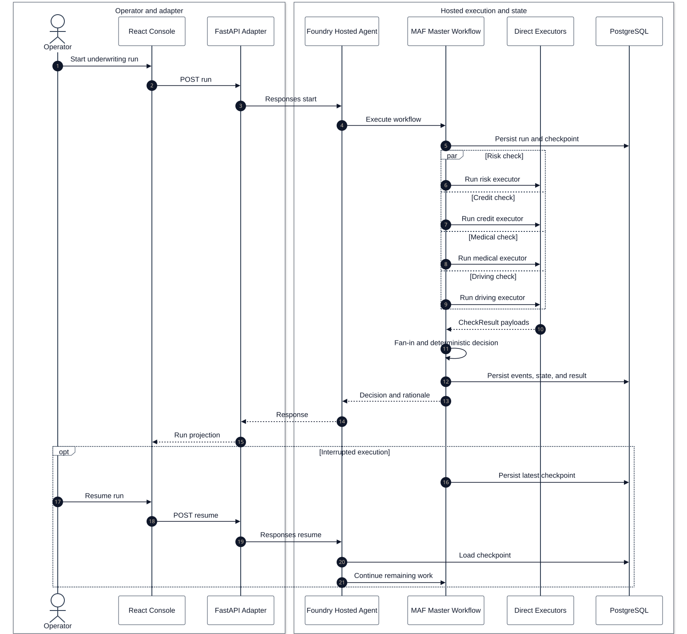

# Architecture: Underwriting Workflow

## Purpose

This document describes the business and runtime architecture for the underwriting use case through four views: logical, process, development, and physical. It also records the clean-cutover operating model for the public hosted lane.

For the rationale behind the initial Underwriting design and the later clean
alignment decisions, see [architecture-decisions.md](architecture-decisions.md).

## Business Problem

Insurance teams need to process applications quickly while keeping decisions explainable, durable, and safe under infrastructure or runtime failures. The system must:

- automate low-risk applications,
- surface deterministic recommendations with transparent score factors and rationale,
- pause only referred cases for a separate human-underwriter decision,
- preserve complete run history and state transitions,
- recover from crashes without duplicating side effects.

## Project Goal

Deliver a verifiable multi-step underwriting workflow that is:

- operationally transparent (run history, event timeline, checkpoints, AG-UI stream),
- decision-safe (deterministic score policy before any model rationale),
- review-safe (immutable machine recommendation plus a separately persisted reviewer outcome),
- durable (PostgreSQL-backed checkpoints and business projections),
- extensible (shared domain contracts across local validation, the internal
  backend adapter, and the hosted agent),
- release-governed (hosted readiness is claimed only from recorded smoke/E2E/eval/telemetry evidence).

## Logical View

The logical view follows an insurance application from intake through parallel assessments, aggregation, and the final underwriting outcome.

Source: [underwriting-logical.mmd](diagrams/underwriting-logical.mmd).

The rendered logical diagram shows the machine-recommendation path. The
review overlay below is the current behavior contract. Diagram source was not
changed in this documentation pass because Mermaid extension validation was
not available.

### Business Decision Model

- Intake creates one underwriting case for the submitted application.
- Risk, credit, medical, and driving assessments run independently and may complete in any order.
- Aggregation proceeds incrementally, but no decision is made until all four assessment results are present.
- The deterministic policy approves when the average score is at least `0.8`, risk is at least `0.6`, and credit is at least `0.65`. Lower average-score bands produce approval with conditions, human referral, or decline.
- Model-generated rationale explains the result but cannot change the policy decision.
- Only `REFER_TO_HUMAN_UNDERWRITER` creates a review checkpoint.
- `APPROVED`, `APPROVED_WITH_CONDITIONS`, and `DECLINED` are terminal machine
  recommendations.
- The machine recommendation remains immutable. A human underwriter records a
  separate `APPROVED` or `DECLINED` reviewer outcome.

## Process View

The process view describes runtime interactions, concurrency, persistence, and recovery behavior.

Source: [underwriting-process.mmd](diagrams/underwriting-process.mmd).

### Underwriting Message Flow

1. `init_context` initializes shared workflow state and emits one check request per required domain.
2. The master workflow fans out directly to the four executors in one superstep.
3. Each direct executor emits one `CheckResult` payload.
4. `fan_in_aggregator` incrementally merges child results into shared state.
5. When all checks complete, `final_decision` computes policy outcome and score breakdown.
6. For a referral, the workflow persists the immutable machine recommendation,
   MAF checkpoint, and pending approval before pausing.
7. A structured, channel-authorized reviewer decision resumes the exact
   checkpoint and is stored separately.
8. Rationale generation enriches the final payload while deterministic decision remains authoritative.
9. Projection and checkpoint stores persist results for history and resume behavior.

### Failure and Recovery

- Middleware wraps check operations with retry/backoff behavior.
- Crash injection can force controlled interruptions after a named executor.
- Resume loads the latest checkpoint by `workflow_run_id` and continues remaining execution only when that checkpoint was written by the deployed master direct-executor graph. Version-40 nested-graph checkpoints are unsupported after deployment; no compatibility workflow or fallback exists.
- Idempotency guards prevent duplicate persistence when replay or resume re-enters completed handlers.
- Teams card actions are opaque, expiring, one-time, and atomically claimed;
  wrong reviewer, wrong conversation, replay, expiry, sibling action, and
  cross-channel attempts fail closed.

## Development View

The development view maps runtime responsibilities to source modules and verification surfaces.

There is one business workflow implementation and one service boundary (`backend/app/modules/underwriting/service.py`).

- `backend/app/main.py` and CLI commands invoke the same service/workflow path for local verification runs.
- `backend/app/server.py` exposes HTTP routes for run/resume/history/state/events/checkpoints.
- `backend/app/server.py` also adds `POST /api/v1/underwriting/ag-ui` for AG-UI event streaming.
- `backend/app/modules/underwriting/service.py:UnderwritingHostedAdapter` relays start/resume operations and projects the shared durable history; it does not construct a second production orchestration path in hosted mode.
- `backend/foundry/main.py` hosts the real Foundry Responses workflow entrypoint and constructs the MAF runner there.
- The same hosted process owns additive Activity handling for Teams; it must
  not construct a second business workflow.

Source: [underwriting-development.mmd](diagrams/underwriting-development.mmd).

### Core Modules

- **Application layer** (`backend/app/modules/underwriting`)
  - Orchestration service boundary and domain decision modeling.
- **Workflow runtime** (`backend/app/maf`)
  - One master workflow, direct risk/credit/medical/driving executors, fan-out/fan-in, middleware, and AG-UI adapters.
- **Persistence adapters** (`backend/app/infrastructure`)
  - PostgreSQL repositories for runs, state, events, results, and idempotency.
  - Real MAF checkpoint storage through `PostgresCheckpointStorage`.
  - Human-review persistence and Teams card-action replay protection.
- **Frontend** (`frontend/src`)
  - Operations console for scenario execution, live progress stream, and run-history inspection.
  - Embedded CopilotKit assistant receives only an allowlisted selected-run
    projection through the internal backend adapter and same-origin frontend
    proxy.

### Execution Surfaces

The same underwriting business flow runs across:

1. Local CLI (`make run`, `make run-crash`, `make resume`).
2. Local FastAPI routes (`/api/v1/underwriting/*`) and AG-UI stream endpoint.
3. Foundry hosted Responses workflow execution correlated to the public request and durable run.
4. Foundry Activity execution for authorized Shared Teams users through the
   same hosted workflow.

### Clean cutover and no-shims rule

The public hosted lane uses an independent clean-cutover operating model:

- the external frontend proxies browser traffic to the internal backend
  adapter, which starts or resumes hosted work and reads durable projections;
- the hosted Responses entrypoint owns production orchestration and writes;
- local execution mode exists only for isolated validation;
- no compatibility shim should reintroduce a second orchestration runtime, shadow checkpoint path, or direct browser-to-Foundry flow.
- superseded nested-graph checkpoints are not a supported resume input after
  deployment; there is no compatibility workflow or fallback.
- Responses/API and Teams checkpoints remain isolated by trusted origin.
- Free-form text is never interpreted as a reviewer decision.

### Verification

1. Functional tests (`backend/tests`) validate fan-out/fan-in, idempotency, and resume behavior.
2. E2E rubric (`frontend/tests/e2e/rubric.ts`) validates operator-facing lifecycle and recovery expectations.
3. Hosted smoke/eval (`make foundry-smoke`, `make foundry-eval`) validates real hosted workflow/model telemetry and public-request correlation.
4. HITL and Teams acceptance validates referral-only pause, immutable
   recommendation, separate reviewer outcome, privacy-safe cards, token
   binding, replay/expiry/concurrency, and cross-channel isolation.
5. Release governance and execution evidence are recorded in [`engineering-operating-model.md`](engineering-operating-model.md) and [`issues-changes-fixes.md`](issues-changes-fixes.md).

## Physical View

The physical view describes the deployed topology, network boundaries, and credential ownership.

Source: [underwriting-physical.mmd](diagrams/underwriting-physical.mmd).

The rendered physical diagram covers the web/Responses path. The additive
Teams boundary is Azure Bot Service plus `MsTeamsChannel` to the Foundry
Activity route. It uses the same hosted process and does not add a private
network. Diagram source was left unchanged pending Mermaid extension
validation.

The internal backend adapter passes start/resume input to the hosted agent only
in the Responses body; it never places application data in Responses metadata.
The browser never receives a Foundry or database credential and never calls
Foundry directly. The backend receives the least-privilege database URL through
an ACA secret, while the hosted agent resolves the same credential through the
project `CustomKeys` connection.

At the Azure edge, only the frontend Container App has external ingress. Its
local Nginx configuration proxies relative `/api` and `/backend-health`
requests to the backend's internal Container Apps FQDN. The browser bundle
contains no Azure backend URL. Backend and hosted-agent startup validate the
administrator-managed PostgreSQL schema with no production runtime DDL.

Teams traffic enters through the service-managed Activity route and Azure Bot
Service authorization. Endpoint reconciliation must retain Responses and
Entra while adding Activity and `BotServiceRbac`. Shared publication limits
catalog distribution, while Foundry RBAC remains the invocation boundary. The
public lane does not enable the private-network-only
`enable_m365_public_endpoint` exception. The Bot endpoint pins the Activity
Protocol API version required by the Foundry data-plane route.

### Durable Stores

PostgreSQL is the durable source of truth for both business and workflow recovery surfaces:

- `maf_checkpoints`: serialized MAF checkpoint payloads.
- `workflow_runs`: run lifecycle summary and status.
- `business_state`: projection of incremental workflow state.
- `workflow_events`: append-only timeline for observability.
- `underwriting_results`: terminal decision outputs.
- `idempotency_records`: replay protection for side-effect safety.
- `underwriting_approvals`: pending/completed referral review with separate
  reviewer outcome.
- `teams_card_actions`: hashed, expiring, bound, atomically claimed Adaptive
  Card actions.

### Hosted Execution Boundary

The backend and hosted runtime use the same dedicated least-privilege
PostgreSQL password over TLS through separate secret-delivery mechanisms.
Password authentication and the narrow required network posture are
release-managed. This prototype intentionally keeps the backend adapter
internal behind the external frontend's same-origin proxy while the hosted
agent owns durable execution.

`UNDERWRITING_EXECUTION_MODE=local` exists only for isolated local E2E
validation. It is never the intended deployed internal-adapter mode.

This architecture document describes the supported contract. It does not
assert that Activity, Teams publication, a particular hosted version, or any
specific Azure environment is currently deployed; the delivery ledger is the
only dated evidence authority.
